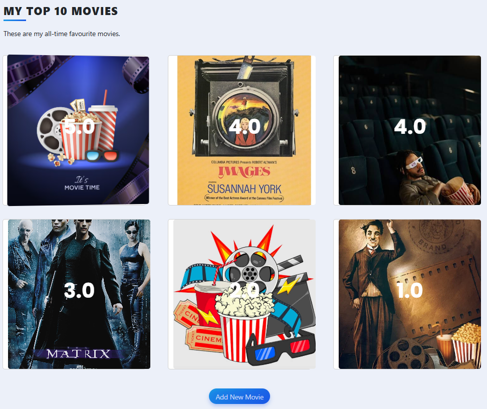
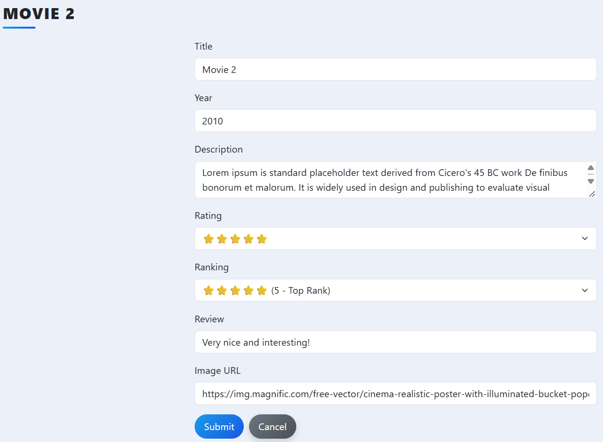
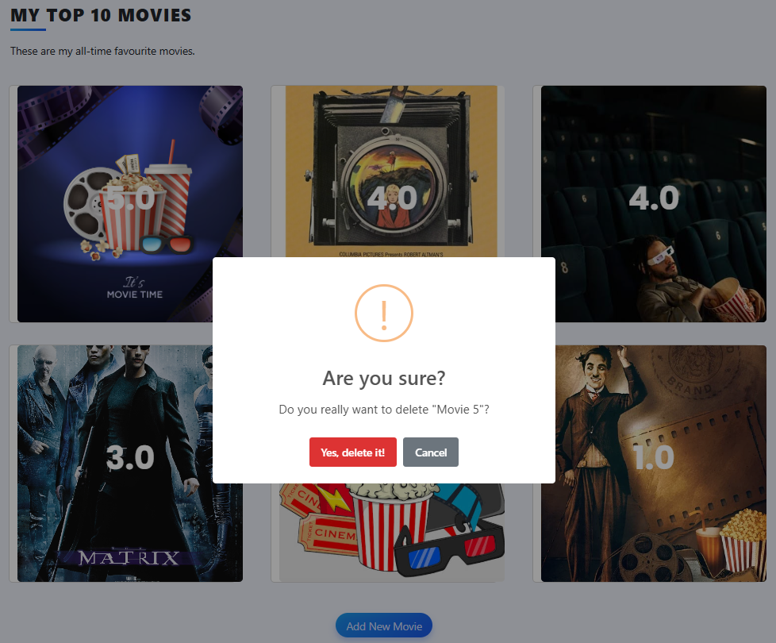

# 🎬 CineRank — Full-Stack Top 10 Movies Web App

A full-stack web application built with **Python**, **Flask**, **SQLAlchemy 2.0**, and **MySQL** that allows users to curate, rank, review, and manage their all-time favorite movies with interactive 3D flip-card UI animations.

The goal of this project is to demonstrate end-to-end full-stack web development with relational database persistence, client-side form validation, and polished frontend UX enhancements.

---

## 🚀 Technologies Used

- **Backend:** Python 3, Flask, SQLAlchemy 2.0 (`Flask-SQLAlchemy`)
- **Database:** MySQL (`PyMySQL`, `cryptography`)
- **Frontend:** HTML5, CSS3, Bootstrap 5 (`Bootstrap-Flask`), Jinja2
- **Forms & Validation:** Flask-WTF, WTForms
- **UI/UX Enhancements:** SweetAlert2, Custom CSS Flip Cards, Full-Screen Loading Overlay
- **Configuration & Version Control:** `python-dotenv`, Git & GitHub

---

## 📌 Project Architecture

```text
Browser (Bootstrap 5 + SweetAlert2 + Loader UI)
      │
      ▼  HTTP Requests (GET / POST)
Flask Application (main.py + Flask-WTF Validation)
      │
      ▼  SQLAlchemy 2.0 ORM + PyMySQL Driver
MySQL Database (python_top_movies -> movies table)
```

---

## ✨ Key Functionality

- **Full CRUD Operations:**
  - **Create (`/add-movie`):** Add new movies with title, release year, description, star rating, ranking, personal review, and poster URL.
  - **Read (`/`):** Automatically queries MySQL, sorts movies by highest rating (`DESC`), dynamically assigns rankings (`#1` to `#10`), and displays them in a responsive 3-column Bootstrap grid.
  - **Update (`/edit/<int:id>`):** Pre-populates existing movie data into the form (`obj=movie_data`) to edit ratings, reviews, or details seamlessly.
  - **Delete (`/delete/<int:id>`):** Removes entries from MySQL after user confirmation.
- **Interactive UI & UX:**
  - **SweetAlert2 Confirmation Modal:** Prompts users with the exact movie title before deleting a record.
  - **Loading Spinner Overlay:** Displays instant visual feedback (`Saving movie...` / `Deleting movie...`) during form submissions and database operations.
  - **Custom 404 Error Page:** Handles non-existent movie IDs (`db.get_or_404`) and invalid URLs gracefully.

---

## 📂 Project Structure

```text
flask-mysql-top-movies/
├── static/
│   └── css/
│       └── styles.css       # Custom 3D flip-card & button styling
├── templates/
│   ├── base.html            # Base layout, Bootstrap 5, SweetAlert2 & Loader
│   ├── index.html           # 3-column responsive movie card grid
│   ├── add.html             # Add new movie form
│   ├── edit.html            # Pre-filled edit movie form
│   └── 404.html             # Custom 404 Not Found page
├── .env                     # Database credentials (ignored by Git)
├── .gitignore               # Excludes .env, venv/, and __pycache__/
├── main.py                  # Flask routes, SQLAlchemy models & WTForms
├── requirements.txt         # Project dependencies
└── README.md                # Project documentation
```

---

## ⚙️ Prerequisites

Before running this project locally, ensure you have installed:

1. **Python 3.10+**
2. **MySQL Server** (MySQL Workbench, XAMPP, or WAMP)
3. **Git**

Verify Python installation:
```bash
python --version
```

---

## 🛠️ Local Setup & Installation

### 1. Clone the Repository
```bash
git clone https://github.com/sanjay-karmakar/python-flask-mysql-top-movies.git
cd flask-mysql-top-movies
```

### 2. Create & Activate a Virtual Environment
```bash
# Windows
python -m venv venv
.\venv\Scripts\activate

# macOS / Linux
python3 -m venv venv
source venv/bin/activate
```

### 3. Install Required Packages
```bash
# Windows users use:
python -m pip install -r requirements.txt

# Mac users use:
pip3 install -r requirements.txt
```

*(Core packages installed: `Flask`, `Flask-SQLAlchemy`, `PyMySQL`, `cryptography`, `Flask-WTF`, `WTForms`, `Bootstrap-Flask`, `python-dotenv`)*

### 4. Create the MySQL Database
Open MySQL Workbench, phpMyAdmin, or your MySQL CLI and create an empty database (SQLAlchemy will automatically generate the `movies` table on startup):
```sql
CREATE DATABASE python_top_movies;
```

### 5. Configure Environment Variables (`.env`)
Create a `.env` file in the root directory and add your MySQL credentials:
```env
DB_USER=root
DB_PASSWORD=your_mysql_password
DB_HOST=localhost
DB_NAME=python_top_movies
```

**Security:** Never upload your `.env` file or database passwords to GitHub.

### 6. Run the Application
```bash
python main.py
```
Open your browser and navigate to **`http://127.0.0.1:5000`**.

---

## 📸 Screenshots

### Home Page (3-Column Responsive Grid & Auto-Ranking)


### Add / Edit Movie Form


### SweetAlert2 Delete Confirmation

> ```

---

## 🔒 `.gitignore`

Ensure the following files and folders are excluded from Git commits:
```text
venv/
__pycache__/
*.pyc
.env
.idea/
```

---

## 🧠 What I Learned

Through building this project, I practiced:
- Connecting **Flask** to a **MySQL** relational database using **SQLAlchemy 2.0** and **PyMySQL**
- Designing database schemas with `Mapped` and `mapped_column` type annotations
- Performing full **CRUD** operations and dynamic `ORDER BY` sorting in SQLAlchemy
- Building and validating server-side forms with **Flask-WTF** and **WTForms**
- Enhancing user experience with **Bootstrap 5**, **SweetAlert2** modals, loading overlays, and custom `404` error handlers
- Managing sensitive credentials securely using `python-dotenv`

---

## 🔄 Future Improvements

- Integrate the **TMDB (The Movie Database) API** to search and auto-fill movie posters, release years, and overviews automatically
- Add **User Authentication** (`Flask-Login` & password hashing) so multiple users can maintain their own personal Top 10 lists
- Implement **Database Migrations** using `Flask-Migrate` (Alembic)
- Deploy the application to a cloud platform (Render / Railway / AWS EC2) with a managed MySQL instance

---

## 👨‍💻 Author

**Sanjay Karmakar**

Full-Stack Python & Flask Developer

- GitHub: [@sanjay-karmakar](https://github.com/sanjay-karmakar)
- LinkedIn: [Connect with me on LinkedIn](https://www.linkedin.com/in/sanjay-karmakar-a05827163/)

### 📌 Tagline
*Turning ideas into clean, interactive full-stack web applications.*
